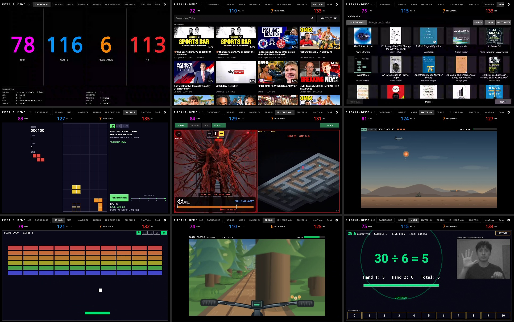

  

  

  
  
  
  
  

**FitBaus Trainer is an open-source fitness and entertainment platform that transforms your workout into something you look forward to.**

Train with structured, heart-rate-guided workouts, play interactive games using body movements or game controllers, watch YouTube, listen to audiobooks, and track your fitness progress.

Built for people who want more from their exercise equipment without mandatory subscriptions, proprietary ecosystems or surrendering ownership of their fitness data.

[Download](#download--get-started) · [Features](#fitness--training) · [Supported Equipment](#supported-equipment--hardware) · [Documentation](#documentation)

## Fitness & Training

The FitBaus Trainer app for Android, iOS and web supports structured cardio workouts and freestyle cycling, with live Bluetooth heart-rate monitoring, heart-rate variability (HRV), heart-rate zone tracking and spoken workout guidance. It also supports resting heart-rate measurements, VO₂ max estimation and automatic resistance adjustment on compatible exercise equipment through the native mobile app.

## Interactive Games

Turn your cardio sessions into interactive gaming experiences. FitBaus features six built-in games that incorporate webcam-based motion tracking, pedaling cadence and game controller support, depending on the game.

| Game | Experience |
|---|---|
| **Trails** | Ride through a forest, navigate winding trails, dodge obstacles and physically stand to jump over ditches. |
| **Maverick** | Pilot a fighter jet through an action-packed aerial arcade experience. |
| **It Hears You** | Navigate a dark industrial maze while avoiding creatures that respond to your activity. |
| **Bricks** | Break bricks by steering a paddle, with optional cadence-based difficulty. |
| **Biketris** | Arrange falling blocks while pedaling to influence the pace of the game. |
| **Math** | Exercise your brain alongside your body with arithmetic challenges. |

Webcam-based controls allow hands-free gameplay, while supported games also offer configurable gamepad controls.

## Entertainment & Learning

Make your workout time entertaining, educational, or both.

- **YouTube:** Browse trending videos, search using text or voice, access your subscriptions and playlists, discover related content, and enjoy picture-in-picture playback while exercising or gaming.
- **Audiobooks:** Connect to your self-hosted Audiobookshelf server to browse your library, listen to books, navigate chapters and synchronize listening progress.
- **Read Along:** Pair with the optional [FitBaus Transcriber](https://github.com/markrai/fitbaus-transcriber) to read synchronized audiobook transcriptions as you listen, with adjustable text size and a distraction-free fullscreen reading mode.

## Workout Analytics & Progress Tracking

Track your fitness journey with locally stored workout history and detailed exercise metrics.

- **Bike console:** Weekly charts showing cycling duration and average cadence, alongside cumulative riding time, pedal revolutions and active days.
- **Trainer app:** Workout summaries, heart-rate samples, time spent in each heart-rate zone, cycling performance data and cardiovascular fitness assessments.
- **Data portability:** Export workout summaries in JSON format for external analysis or integration with other applications.

## Supported Equipment & Hardware

| Hardware | Support |
|---|---|
| **ProForm Smart Power 10.0** | Native console integration, live bike telemetry, resistance control, games and entertainment. |
| **Bluetooth heart-rate monitors** | Live heart-rate monitoring and HRV with compatible sensors. |
| **USB webcams** | Motion-controlled gameplay using face and hand tracking. |
| **Game controllers** | Configurable controls for supported games. |
| **Android & iOS devices** | Standalone fitness training and supported bike integration. |
| **Compatible web browsers** | Standalone fitness training through the web app. |

The Trainer app does not require a connected exercise bike. Native equipment integration is currently limited to the ProForm Smart Power 10.0.

Contributions to expand support to other exercise equipment are welcome.

See the [Equipment Bridge documentation](equipment-bridges/README.md) for compatibility, installation and safety information.

## FitBaus Lite vs. Full

FitBaus is available in two free, open-source editions.

| | Lite (1.x) | Full (2.x) |
|---|:---:|:---:|
| Bike dashboard & telemetry | ✓ | ✓ |
| Trainer app integration | ✓ | ✓ |
| Automatic resistance control | ✓ | ✓ |
| Built-in arcade games | ✓ | ✓ |
| External USB webcam support | — | ✓ |
| Extended game library | — | ✓ |
| Configurable gamepad support | — | ✓ |
| YouTube integration | — | ✓ |
| Audiobooks & Read Along | — | ✓ |
| Weekly bike analytics | — | ✓ |
| Active feature development | — | ✓ |

**Lite** is designed for older consoles with limited available storage.

**Full** delivers the complete FitBaus experience and is the recommended edition for users with sufficient storage.

Both editions are free. There is no premium subscription or paid feature unlock.

## Download & Get Started

Download FitBaus from the [GitHub Releases](https://github.com/markrai/fitbaus-trainer/releases) page.

| Platform | Installation |
|---|---|
| **Android phone or tablet** | Download and install the Trainer APK. |
| **ProForm Smart Power 10.0** | Download the Lite or Full Bike Bridge APK and follow the [console setup guide](equipment-bridges/proform-smart-power-10/README.md). |
| **iOS** | Build from source using Xcode. See the [native development guide](docs/NATIVE-DEVELOPMENT.MD). |
| **Web / PWA** | Download the web deployment package or build from source. |

No FitBaus account or subscription is required.

See the [Changelog](CHANGELOG.md) for the latest features and improvements.

## Self-Hosting

FitBaus Trainer can be self-hosted as a lightweight static web application. No backend, database, authentication server or cloud service is required.

Download the web deployment package from [GitHub Releases](https://github.com/markrai/fitbaus-trainer/releases) and serve it using your preferred web server over HTTPS.

### Optional Companion Services

- **[Audiobookshelf](https://github.com/advplyr/audiobookshelf):** Host your own audiobook library and stream books directly to FitBaus.
- **[FitBaus Transcriber](https://github.com/markrai/fitbaus-transcriber):** A self-hosted, Docker-based companion service that uses local speech recognition models to generate synchronized audiobook transcriptions, enabling Read Along without relying on cloud AI services.

Neither service is required for the core FitBaus experience. Audiobook playback does not require the Transcriber.

For deployment instructions, see the [Self-Hosting Guide](docs/SELF-HOSTING.md).

## Privacy & Data Ownership

Your fitness data belongs to you. FitBaus stores workout history, athlete profiles and exercise metrics locally, without requiring a cloud account.

Webcam-based motion tracking is processed on the device, and optional audiobook transcription runs on your own server.

External services, such as YouTube and optional SISU synchronization, are entirely optional. You decide which services to connect and where your data goes.

### Disclaimer

FitBaus is provided "as is", without warranty of any kind. It is not a medical device and is not intended to provide medical advice, diagnosis or treatment.

Use of this software, including its exercise equipment integration, automatic resistance control and interactive games, is entirely at your own risk.

To the fullest extent permitted by applicable law, the developers, maintainers and contributors accept no liability for personal injury, equipment damage, data loss or any other direct, indirect, incidental or consequential damages arising from the use or misuse of this software.

Always exercise within your physical capabilities and follow your equipment manufacturer's safety guidelines.

## Documentation

| Guide | Description |
|---|---|
| [Equipment Bridges](equipment-bridges/README.md) | Supported exercise equipment and hardware integration |
| [ProForm Setup](equipment-bridges/proform-smart-power-10/README.md) | Bike console configuration and safety |
| [Self-Hosting](docs/SELF-HOSTING.md) | Web deployment and Docker configuration |
| [YouTube Setup](docs/YOUTUBE-GOOGLE-OAUTH-SETUP.md) | Connecting your YouTube account |
| [FitBaus Transcriber](https://github.com/markrai/fitbaus-transcriber) | Audiobook transcription and Read Along setup |
| [Native Development](docs/NATIVE-DEVELOPMENT.MD) | Android and iOS development |
| [Versioning](VERSIONING.md) | Version management and release procedures |
| [Changelog](CHANGELOG.md) | Release history and improvements |

## Contributing

FitBaus welcomes contributions from developers, fitness enthusiasts and hardware tinkerers.

Areas where contributions are particularly welcome:

- Support for additional exercise equipment
- New interactive games
- Workout protocols and exercise science
- Performance and accessibility improvements
- Bug fixes, documentation and translations

Have an idea, feature request or bug report? Open an [issue](https://github.com/markrai/fitbaus-trainer/issues) or submit a [pull request](https://github.com/markrai/fitbaus-trainer/pulls).

For larger changes, please open an issue for discussion before beginning implementation.

## License

FitBaus Trainer is free and open-source software licensed under the [GNU Affero General Public License v3.0 (AGPL-3.0)](LICENSE).

You are free to use, study, modify and redistribute the software in accordance with the terms of the license.
